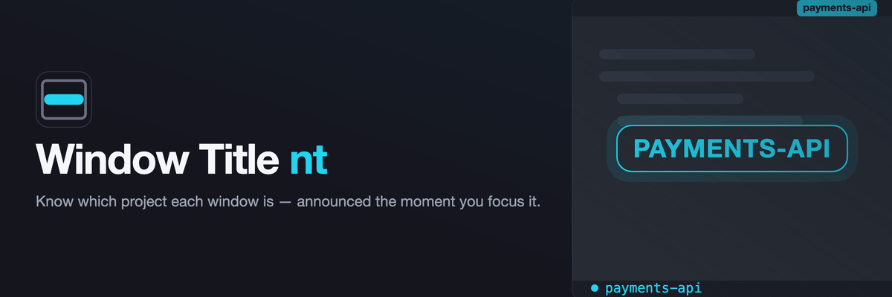

# Window Title nt

  

**Know which project a VS Code window belongs to, at a glance.**

One window per repository. Five of them open. They all look identical, the folder name is buried in the title bar, and you have already typed into the wrong one twice today.

This puts the project name where you cannot miss it — in the status bar, always, and across your editor the moment you switch into the window.

## What you get

**A badge that is always there.** The project name sits in the status bar in cyan, on whichever side you prefer. Click it to announce the name again. Rename it per project if the folder name is not the name you think in.

**An announcement when you switch in.** Alt-tab into the window and the name appears over your code for about a second, then vanishes on its own. It is sized to be read without looking for it, and its color is yours to pick, so it looks the same in every theme.

**Nothing running in the background.** No polling, no network, no files touched, no dependencies — and nothing is ever written to your VS Code installation. It wakes up when you focus a window and goes straight back to sleep.

Prefer a keyboard shortcut? Bind **Window Title nt: Announce Project Name** and see it without switching windows at all.

## Make it yours

| Setting                                            | Default     | What it does                                                                         |
| -------------------------------------------------- | ----------- | ------------------------------------------------------------------------------------ |
| `ntWindowTitle.label`                              | `""`        | Show this name instead of the folder name. Set it per project in workspace settings. |
| `ntWindowTitle.statusBar.enabled`                  | `true`      | Show the badge.                                                                      |
| `ntWindowTitle.statusBar.alignment`                | `"left"`    | Which end of the status bar the badge sits on.                                       |
| `ntWindowTitle.statusBar.color`                    | `"#22D3EE"` | Hex color, or a theme color id such as `terminal.ansiCyan` to follow your theme.     |
| `ntWindowTitle.statusBar.icon`                     | `"window"`  | Codicon shown before the name. Empty for none.                                       |
| `ntWindowTitle.statusBar.flashOnFocus`             | `true`      | Briefly highlight the badge when the window gains focus.                             |
| `ntWindowTitle.statusBar.flashMilliseconds`        | `1200`      | How long that lasts. 200–10000.                                                      |
| `ntWindowTitle.editorAnnouncement.enabled`         | `true`      | Announce the project name in the editor on focus.                                    |
| `ntWindowTitle.editorAnnouncement.milliseconds`    | `1200`      | How long it stays. 200–10000.                                                        |
| `ntWindowTitle.editorAnnouncement.color`           | `""`        | Hex color or theme color id. Empty reuses the badge color.                           |
| `ntWindowTitle.editorAnnouncement.uppercase`       | `true`      | Announce in capitals.                                                                |
| `ntWindowTitle.editorAnnouncement.fontSizePercent` | `220`       | Size, as a percentage of your editor font. 100–500.                                  |
| `ntWindowTitle.editorAnnouncement.position`        | `center`    | `center` of the visible lines, or `top` just below the first.                        |

Without a `label`, the name is your workspace's own name in a multi-root workspace, and the open folder's name otherwise.

## Good to know

The editor announcement needs a file open — on the Welcome tab or the Settings UI there is nothing to draw on, and the status-bar badge carries the name instead.

The badge highlight on focus uses the one prominent background VS Code allows an extension to set. A few themes tint that close to the badge's own color, which makes it subtle; the editor announcement is the one that looks the same everywhere.

## Licence

MIT
